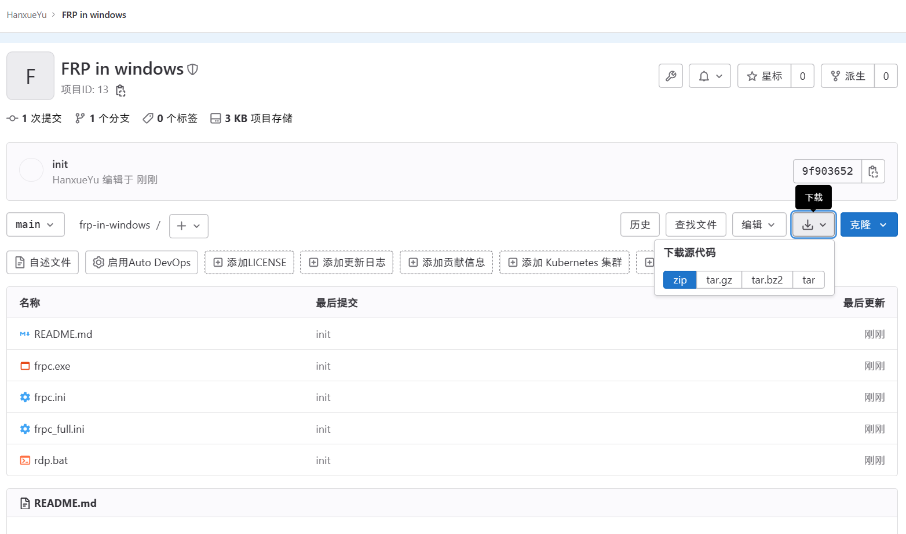
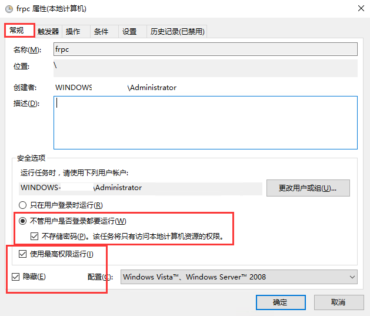
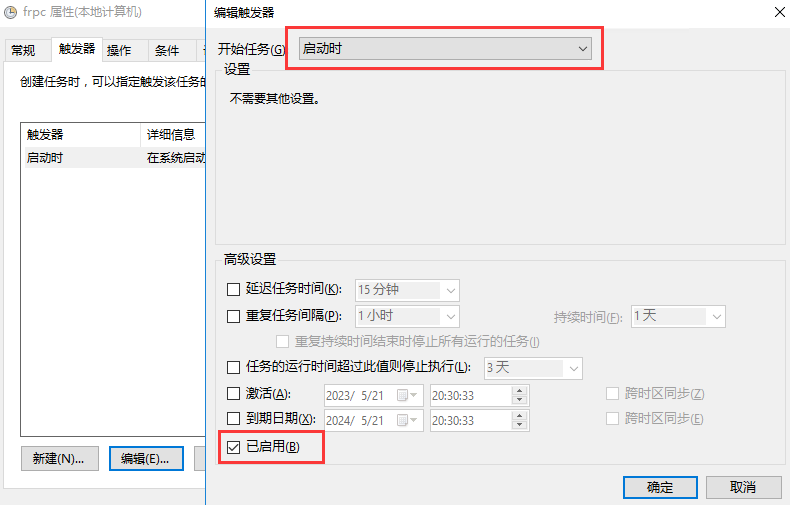
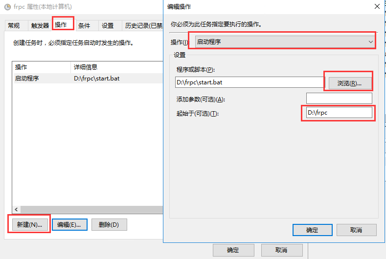
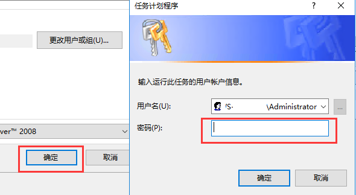

# 在 Windows 开机时启动FRP

使用Frp内网穿透，远程访问端口

## Install

1. 下载本存储库并解压至某一目录（最好不要带中文）
    
2. [frp](https://gofrp.org/zh-cn/) 程序内置了GO 可能会被杀毒软件误杀，请放至白名单。
3. 修改frpc.ini
   - `[common]`为远程服务器配置，如果使用公用服务器请不要修改

        ```ini
        [common]
        server_addr = 43.163.203.252
        server_port = 52013
        token=12345678123456781234567812345678123456781234567812345678
        ```  

   - 在配置文件中自行添加端口，例如以下把本地端口`3389`穿透至远程服务器端口`5200`

        ```ini
        [rdp]
        type = tcp
        local_ip = 127.0.0.1
        local_port = 3389
        remote_port = 5200
        ```

        `type`:连接类型，常见的有`tcp`，`udp`
        `local_ip`:穿透的本地IP，`0.0.0.0`,`127.0.0.1`都是本地地址
        `local_port`:需要穿透的端口
        `remote_port`:远程访问端口
   - 可以在[frp-dashboard](http://43.163.203.252:7500/static/#/proxies/tcp)(账密:admin)查看可用远程端口
   - 联系[管理员](yhx910@ouc.edu.cn)从服务器防火墙放行远程端口
   - 配置完成后可以双击`rdp.bat`查看frp是否正常运行
   - 更多穿透方法请参考<https://gofrp.org/zh-cn/docs/examples/>

4. 添加windows自启
   - 打开搜索地址栏，输入 “任务计划程序” 将会自动搜索，找到后打开任务计划程序，点击右侧的 “创建任务”，开始创建如下：
     - 常规：
        1. 名称：随意填写比如frpc
        2. 安全选项：选择 “不管用户是否登录都要运行”，不存储密码建议不勾选，勾选也可以
        3. 使用最高权限运行：勾选上，根据个人需要选择
        4. 隐藏：勾选上，就不会在启动时弹出命令行窗口了
        
     - 触发器：
        1. 点击新建
        2. 开始任务：选择 “启动时”
        3. 已启用：勾选上
        4. 确定
        
     - 操作：
        1. 新建
        2. 操作：选择 启动程序
        3. 设置：程序或脚本，浏览选择bat运行目录比如：D:\frpc\start.bat
        4. 起始于（可选）：输入bat的上级目录比如：D:\frpc\
        5. 确定
        
     - 返回常规：
        1. 返回常规栏目，点击确定，此时会要求输入密码，输入你的电脑密码，然后点击确定即可。
        2. 这样开机自动启动 frp 了，并且不会弹出命令提示符窗口。 
        

## 参考

[1. FRP 官网](https://gofrp.org/zh-cn/)  
[2. Windows 任务计划程序设置程序frpc自启动服务以及出现0X41301错误解决方法](http://www.kaixinit.com/info/maintenance/8212.html)  
[3. FRP Github](https://github.com/fatedier/frp)  
[4. FRP Dashborad](http://43.163.203.252:7500/static/#/proxies/tcp)  
